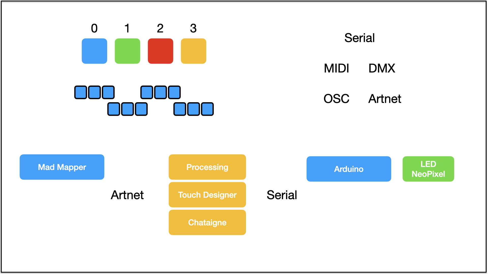

# 1020_WS2812 NeoPixel


### Context

* WS2812 사용하기
* MadMapper와 LED 연동

----

## WS2812_NeoPixel 사용하기 

* 연결 방법

```
    NeoPixel은 3핀으로 여러개의 LED가 연결되어 있음
    Pin_GND : 아두이노 GND
    Pin_VCC : 아두이노 5V
    Pin_DAT : 아두이노 GPIO 핀 중 하나
```

* Adafruit NeoPixel by Adafruit Library 설치 후 사용 

```cpp title="ultrasonic_servo.ino" linenums="1"
#include <Adafruit_NeoPixel.h>

#define PIXEL_PIN       6           // 아두이노에서 NeoPixel 연결하는 핀
#define PIXEL_CNT       4           // NeoPixel 수

Adafruit_NeoPixel pixels(PIXEL_CNT, PIXEL_PIN, NEO_GRB + NEO_KHZ800);
                                    // NeoPixel Class 연결

void setup() {
  pixels.begin();
}

void loop() {
  pixels.clear();
  pixels.setPixelColor(0, pixels.Color(150, 0, 0));
  pixels.setPixelColor(1, pixels.Color(0, 150, 0));
  pixels.setPixelColor(2, pixels.Color(0, 0, 150));
  pixels.setPixelColor(3, pixels.Color(100, 150, 250));
  pixels.show();
}
```

#### 도전

* 시리얼로 숫자 3개 받아서 첫번째 Pixel의 컬러를 바꿔보자
* 시리얼로 숫자 12개 받아서 Pixel 4개 컬러를 바꿔보자
* 시리얼로 숫자 4개 받아서 지정된 자리의 Pixel 컬러를 바꿔보자
    - 배열 사용하기
    - 배열 초기화, 배열에 데이터 넣기

#### 생각해 볼 문제

* 숫자 여러개를 보내서 여러개 LED 색깔 바꾸기 vs. 숫자 4개 보내서 지정된 위치의 색깔 바꾸기 장단점은?

----

## Mad Mapper와 NeoPixel 연동하기

* MadMapper는 시리얼 출력이 없음
* MadMapper에서 조명기(DMX-Fixture) 사용해 출력
* 조명기(Fixture)로 LED 지정, LED 숫자와 배치 방법 정하기
* DMX 채널 설정 후 Artnet 으로 출력 지정
* 색깔 변화를 주면 DMX 신호로 바뀌어 출력됨
* DMX 신호는 DMX 인터페이스 혹은 Artnet 단자로 출력됨
* DMX 또는 Artnet 신호를 시리얼로 바꾸는 작업 필요
* Artnet을 시리얼로 바꾸기는 TouchDesigner / Processing 에서 가능

{ .with-border width="600px" }
----

#### 숫자 4개 입력 받아 지정된 자리 Pixel 바꾸기 1

* 숫자 4개 입력 받음
* 첫 번째 숫자는 Pixel 위치, 나머지 3개는 RGB 컬러값
* 지정된 위치의 Pixel 컬러를 바꾼다

```cpp
#include <Adafruit_NeoPixel.h>

#define PIXEL_PIN       6           // 아두이노에서 NeoPixel 연결하는 핀
#define PIXEL_CNT       4           // NeoPixel 수

Adafruit_NeoPixel pixels(PIXEL_CNT, PIXEL_PIN, NEO_GRB + NEO_KHZ800);
                                    // NeoPixel Class 연결

void setup() {
  Serial.begin(115200);
  pixels.begin();
}

void loop() {
  while(Serial.available() > 0) {
    int data1 = Serial.parseInt();
    int data2 = Serial.parseInt();
    int data3 = Serial.parseInt();
    int data4 = Serial.parseInt();
    if(Serial.read() == '\n') {
      pixels.clear();
      pixels.setPixelColor(data1, pixels.Color(data2, data3, data4));
      pixels.show();
    }
  }
}
```

#### 숫자 4개 입력 받아 지정된 자리 Pixel 바꾸기 2

* Pixel 마다 3가지 색 데이터가 저장되는 배열을 만들어 값을 저장
* 시리얼로 읽어서 배열에 데이터 넣기
* 배열 데이터를 읽어 Pixel 출력하기

```cpp
#include <Adafruit_NeoPixel.h>

#define PIXEL_PIN       6           // 아두이노에서 NeoPixel 연결하는 핀
#define PIXEL_CNT       4           // NeoPixel 수
Adafruit_NeoPixel pixels(PIXEL_CNT, PIXEL_PIN, NEO_GRB + NEO_KHZ800);
int pixel_color[PIXEL_CNT *3];

void setup() {
  Serial.begin(115200);
  pixels.begin();
  for(int i=0; i < PIXEL_CNT *3; i++) {
    pixel_color[i] = 0;
  }
}

void loop() {
  while(Serial.available() > 0) {
    int data1 = Serial.parseInt();
    int data2 = Serial.parseInt();
    int data3 = Serial.parseInt();
    int data4 = Serial.parseInt();

    if(Serial.read() == '\n') {
      int idx_c = data1*3;
      pixel_color[idx_c+0] = data2;
      pixel_color[idx_c+1] = data3;
      pixel_color[idx_c+2] = data4;
    }

    pixels.clear();
    int idx = 0;
    for(int i=0; i < PIXEL_CNT; i++) {
      idx = i;
      int idx_c=idx*3;
      pixels.setPixelColor(idx, pixels.Color(pixel_color[idx_c+0], pixel_color[idx_c+1], pixel_color[idx_c+2]));
    }
    pixels.show();
  }
}
```